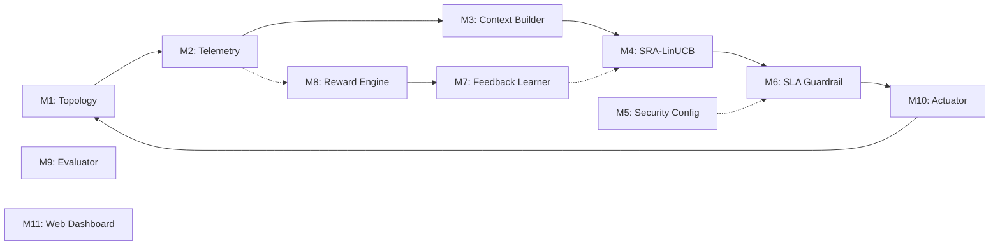

# AI-Driven Safe Dynamic Network Slicing for SLA-Preserving SDN Networks
## Comprehensive Technical Reference & Research Paper Compendium

> **Notice:** This document is the authoritative, research-oriented technical reference for the project **AI-Driven Safe Dynamic Network Slicing for SLA-Preserving SDN Networks**. It provides verified implementation details, mathematical models, experimental results, and architectural specifications based strictly on the codebase. All existing source code, tests, and configuration files remain preserved. The root `README.md` is preserved without modification.

---

## Table of Contents
1. [Project Overview](#1-project-overview)
2. [Strong Problem Statement](#2-strong-problem-statement)
3. [Research Gap and Proposed Contribution](#3-research-gap-and-proposed-contribution)
4. [System Architecture](#4-system-architecture)
5. [Topology and Traffic Slices](#5-topology-and-traffic-slices)
6. [Technology Stack and Design Choices](#6-technology-stack-and-design-choices)
7. [Complete Module-by-Module Documentation](#7-complete-module-by-module-documentation)
8. [Mathematical Formulation and AI Algorithm](#8-mathematical-formulation-and-ai-algorithm)
9. [Telemetry, Metrics, and Data Quality](#9-telemetry-metrics-and-data-quality)
10. [Security and SLA Protection](#10-security-and-sla-protection)
11. [Phase 10 — Data-Plane Actuation](#11-phase-10--data-plane-actuation)
12. [Phase 11 — Web Dashboard](#12-phase-11--web-dashboard)
13. [Experimental Methodology](#13-experimental-methodology)
14. [Results and Interpretation](#14-results-and-interpretation)
15. [Testing and Verification](#15-testing-and-verification)
16. [Installation and Reproducibility](#16-installation-and-reproducibility)
17. [Repository Structure and Key Files](#17-repository-structure-and-key-files)
18. [Known Limitations and Future Work](#18-known-limitations-and-future-work)
19. [Research-Paper Writing Reference](#19-research-paper-writing-reference)
20. [Source Traceability and Research Checklist](#20-source-traceability-and-research-checklist)

---

## 1. Project Overview

### Full Title
**AI-Driven Safe Dynamic Network Slicing for SLA-Preserving SDN Networks**

### Abstract-Style Summary
Next-generation multi-tenant Software-Defined Networks (SDN) must simultaneously support heterogeneous service classes with fundamentally conflicting Quality of Service (QoS) requirements—specifically Ultra-Reliable Low-Latency Communication (URLLC), Enhanced Mobile Broadband (eMBB), and elastic Best-Effort (BE) traffic over shared physical infrastructure. Conventional static resource slicing partitions link capacity rigidly, resulting in severe resource underutilization during low-demand periods and queue congestion during bursty surges. Conversely, unconstrained Artificial Intelligence / Machine Learning (AI/ML) models dynamically adjusting resource allocations can cause catastrophic Service Level Agreement (SLA) violations during transient exploration phases or under unexpected traffic surges.

This project implements and evaluates an end-to-end framework combining **Security- and Risk-Aware Contextual Bandits (SRA-LinUCB)** with an independent, pre-execution **Deterministic SLA and Security Guardrail** operating atop an OpenFlow 1.3 Open vSwitch (OVS) data plane. The contextual bandit adaptively optimizes slice bandwidth allocations based on physical telemetry, while the deterministic guardrail mathematically enforces total capacity invariants ($C \le 10.0\text{ Mbps}$), URLLC minimum bandwidth reservations ($B_{\text{URLLC}} \ge 3.0\text{ Mbps}$), strict latency ceilings ($L_{\text{URLLC}} \le 15.0\text{ ms}$), packet loss bounds ($P_{\text{loss}} \le 1.0\%$), and cryptographic overhead allowances. The data plane is actuated via Linux Traffic Control (`tc`) Hierarchical Token Bucket (HTB) classes and OpenFlow queue classification. In trace-driven simulation evaluations under high-load eMBB traffic surges, the proposed framework completely prevented the SLA breaches exhibited by unconstrained dynamic allocation (reducing 99th-percentile URLLC latency from $26.35\text{ ms}$ to $12.51\text{ ms}$, representing a $52.5\%$ latency reduction) while maintaining high eMBB throughput.

### Project Motivation
1. **Infrastructure Sharing:** Physical infrastructure deployment is expensive; multiple tenants must share common bottleneck links.
2. **QoS Divergence:** URLLC applications (e.g., industrial automation, vehicular telematics) cannot tolerate latency $>15\text{ ms}$ or loss $>1\%$, whereas eMBB applications (e.g., video streaming) demand multi-megabit throughput but tolerate variable buffering.
3. **The Static Inefficiency Dilemma:** Fixed allocations permanently partition bandwidth, wasting bandwidth when high-priority slices are idle and causing packet drops when low-priority traffic surges.
4. **The Unsafe AI Dilemma:** Reinforcement learning or bandit agents optimizing aggregate utility or throughput routinely starve latency-sensitive slices during exploration, violating hard mission-critical SLAs.

### Scope & Status
- **Modules 1–9:** Implemented, unit-tested, and evaluated via trace-driven FIFO simulation benchmarks (114 baseline tests).
- **Phase 10 (Actuator):** Implemented in `controller/slicing_actuator.py` with 25 unit/integration tests covering atomic Linux `tc` command generation, OpenFlow queue rule mapping, numerical tolerance read-back verification, and automatic rollback on failure.
- **Phase 11 (Dashboard):** Implemented in `dashboard/app.py` with 15 automated tests covering data parsing, sentinel `-1.0` separation, multi-stage data plane verification, and full Streamlit headless smoke testing.
- **Total Test Suite:** 154 automated tests passing with 100% success rate under `pytest`.

---

## 2. Strong Problem Statement

### 2.1 The Technical Context: Contention on Shared Links
When heterogeneous network slices share a single physical egress interface (e.g., $10.0\text{ Mbps}$ bottleneck link between switches `s1` and `s2`):
- High-volume eMBB burst traffic fills the switch egress buffer.
- Latency-sensitive URLLC probe packets queued behind large eMBB packets experience queue bufferbloat, causing round-trip latency to surge from a nominal baseline of $\approx 10.15\text{ ms}$ to $>26\text{ ms}$, severely breaching the $15.0\text{ ms}$ SLA threshold.
- Unconstrained AI algorithms attempting to maximize overall throughput allocate surplus capacity to eMBB, inadvertently starving URLLC and causing packet drops.

### 2.2 Formal Problem Statement
Let a shared SDN bottleneck link possess aggregate physical capacity $C_{\text{total}} = 10.0\text{ Mbps}$ and a finite egress buffer of $Q_{\text{max}} = 50\text{ packets}$. The link serves a set of active slices $\mathcal{S} = \{\text{URLLC}, \text{eMBB}, \text{BE}\}$ with dynamic offered loads $\mathbf{d}_t = (d_t^{\text{URLLC}}, d_t^{\text{eMBB}}, d_t^{\text{BE}})^T$.

The objective is to find a dynamic bandwidth allocation vector $\mathbf{b}_t = (b_t^{\text{URLLC}}, b_t^{\text{eMBB}}, b_t^{\text{BE}})^T$ for each time interval $t$ that maximizes aggregate network utility and elastic eMBB throughput:
$$\max_{\mathbf{b}_t} \; \sum_{t} \mathcal{U}(\mathbf{b}_t, \mathbf{d}_t)$$
Subject to the hard physical and SLA constraints:
$$\sum_{s \in \mathcal{S}} b_t^s \le C_{\text{total}} = 10.0\text{ Mbps}, \quad \forall t$$
$$b_t^{\text{URLLC}} \ge B_{\text{URLLC}}^{\text{min}} = 3.0\text{ Mbps}, \quad \forall t$$
$$L_t^{\text{URLLC}} + \Delta L_{\text{sec}} \le L_{\text{SLA}}^{\text{URLLC}} = 15.0\text{ ms}, \quad \forall t$$
$$P_{\text{loss}, t}^{\text{URLLC}} \le P_{\text{SLA}}^{\text{URLLC}} = 1.0\%, \quad \forall t$$
$$b_t^s \ge 0, \quad \forall s \in \mathcal{S}$$

### 2.3 Research Question
> *Can an online contextual-bandit resource allocator paired with a deterministic, pre-execution safety guardrail achieve elastic bandwidth reallocation for throughput-hungry slices while guaranteeing zero SLA violations for mission-critical low-latency slices under heavy traffic surges?*

---

## 3. Research Gap and Proposed Contribution

### 3.1 Prior Art & Research Gap
1. **Static Partitioning (Conventional Slicing):** Guarantees SLA isolation by statically provisioning maximum peak bandwidth to URLLC. However, because URLLC traffic is bursty and low-volume ($1.0$–$1.8\text{ Mbps}$), up to $70\%$ of reserved URLLC capacity lies idle while competing eMBB flows suffer packet drops.
2. **Pure Reinforcement Learning (Deep RL / DDPG / PPO):** High sample complexity, susceptibility to catastrophic forgetting, and non-deterministic exploration. During initial learning episodes, RL agents frequently explore unsafe actions that drop URLLC traffic.
3. **Standard LinUCB Bandits:** Adapt quickly to linear contexts with low computational overhead ($O(d^2)$ per update), but optimize solely for expected scalar reward without hard constraint satisfaction guarantees.
4. **The Critical Gap:** Existing literature either relies on soft penalty terms in the reward function (which cannot mathematically prevent transient constraint violations) or reverts to conservative static allocations that sacrifice multi-tenant multiplexing gain.

### 3.2 Proposed Technical Approach
This project implements a **two-tier defense-in-depth architecture**:
- **Tier 1 (Soft Optimization — AI Module):** A Security- and Risk-Aware Contextual Bandit (**SRA-LinUCB**) consumes a normalized 6-dimensional telemetry context vector $\mathbf{x}_t \in \mathbb{R}^6$ and incorporates a physical risk penalty $\lambda \rho_a R(\mathbf{x}_t)$ directly into candidate arm scoring.
- **Tier 2 (Hard Deterministic Gatekeeper — Guardrail):** An independent deterministic safety module intercepting candidate allocations prior to execution. If an AI proposal violates physical link capacity or minimum reservation floors, the guardrail performs an atomic, deterministic mathematical repair (preserving URLLC reservation first, allocating eMBB second, and assigning remainder to Best-Effort). If an environmental SLA violation is detected (e.g., external congestion), the proposal is blocked.

### 3.3 Explicit Delineation of Contributions

| Dimension | Implemented & Unit-Tested in Code | Evaluated in Simulation (Module 9) | Live Mininet Demonstrated | Remaining Research Gap |
| :--- | :--- | :--- | :--- | :--- |
| **Telemetry Ingestion** | Yes (`telemetry/monitor.py`) | Yes (`data/telemetry.csv`) | Yes (ping & `/sys` stats) | Automated high-frequency streaming telemetry |
| **Context Extraction** | Yes (`ai/context_builder.py`) | Yes (Trace-driven inputs) | Verified via dry-run | Multi-hop switch context aggregation |
| **SRA-LinUCB Bandit** | Yes (`ai/linucb.py`) | Yes (20-step surge evaluation) | Verified via dry-run | Non-linear neural contextual bandits |
| **Deterministic Guardrail** | Yes (`guardrail/guardrail.py`)| Yes (Repaired 3 surge actions)| Verified via dry-run | Multi-bottleneck joint constraint solving |
| **Reward & Feedback Loop** | Yes (`feedback/` 3 modules) | Yes (Reward updates recorded)| Verified in integration tests| Real-time online policy retraining under Mininet |
| **Data-Plane Actuation** | Yes (`controller/slicing_actuator.py`)| N/A (Unit/Mock runner verified)| Verified via `tc` mock & dry-run | Live kernel execution under continuous traffic |
| **Interactive Dashboard**| Yes (`dashboard/app.py`)| Yes (Displays benchmarks & logs)| Verified via AppTest smoke | Dynamic live Mininet WebSockets streaming |

*Scientific Novelty Disclaimer:* Standard LinUCB and Linux `tc` HTB are established technologies. The specific contribution of this project is the **closed-loop architectural synthesis of contextual bandits with a deterministic pre-execution guardrail and automated data-plane rate actuation for SDN network slicing**. Claims of superiority over state-of-the-art deep RL require further literature benchmarking against published algorithms (e.g., DDPG, SAC).

---

## 4. System Architecture

### 4.1 End-to-End Pipeline
The operational closed-loop architecture operates in discrete cyclic epochs ($t = 1, 2, \dots$):

```mermaid
flowchart TD
    subgraph DataPlane ["Data Plane (Mininet / Open vSwitch)"]
        H1["Host h1 (URLLC TX)"] --> S1["Switch s1 (OpenFlow 1.3)"]
        H2["Host h2 (eMBB TX)"] --> S1
        H3["Host h3 (BE TX)"] --> S1
        S1 -- "Bottleneck Link (s1-eth4)\n10 Mbps, 5ms delay, 50 pkt buffer" --> S2["Switch s2"]
        S2 --> H4["Host h4 (URLLC RX)"]
        S2 --> H5["Host h5 (eMBB RX)"]
        S2 --> H6["Host h6 (BE RX)"]
    end

    subgraph TelemetryModule ["Module 2: Telemetry Probing"]
        M_Lat["Active Ping Probe\n(h1 -> h4 RTT)"]
        M_Stats["Passive sysfs Stats\n(rx_bytes, tx_bytes)"]
        M_Queue["tc Backlog Query\n(queue occupancy)"]
    end

    DataPlane --> TelemetryModule

    subgraph ContextModule ["Module 3: Context Builder"]
        CB["Extract & Normalize:\n- Bias term (1.0)\n- Latency norm\n- Throughput norm\n- Queue norm\n- Latency trend\n- Loss ratio"]
    end

    TelemetryModule -->|Raw Telemetry| ContextModule

    subgraph AIModule ["Module 4: SRA-LinUCB Engine"]
        LinUCB["Score Arms a in {0,1,2}:\nScore = UCB - lambda * rho * R(x_t)\nSelect a_t = argmax Score"]
    end

    ContextModule -->|"Context Vector x_t in R^6"| AIModule

    subgraph GuardrailModule ["Module 6: Deterministic SLA & Security Guardrail"]
        direction TB
        G_Check{"Validation:\n1. Total <= 10 Mbps?\n2. URLLC >= 3 Mbps?\n3. Latency <= 15 ms?\n4. Loss <= 1.0%?\n5. Security overhead?"}
        G_Approve["APPROVED\n(Forward candidate)"]
        G_Repair["REPAIRED\n(Deterministic repair:\nURLLC=3.0, eMBB=..., BE=...)"]
        G_Reject["REJECTED / BLOCKED\n(Preserve baseline)"]
        G_Check -->|All Safe| G_Approve
        G_Check -->|Allocation Breach| G_Repair
        G_Check -->|SLA Breach| G_Reject
    end

    AIModule -->|Candidate Action| GuardrailModule
    TelemetryModule -.->|Environmental Context| GuardrailModule

    subgraph ActuationModule ["Module 10: Slicing Actuator"]
        ACT_Valid["Validate Decision Integrity"]
        ACT_Cmd["Build Linux tc HTB Commands\n& OpenFlow Queue Mappings"]
        ACT_Exec["Execute 'tc class replace'"]
        ACT_Verify["Read-Back Verification\n('tc -s class show')"]
        ACT_Rollback["Safety Rollback on Failure\n(Fallback: 3.0 / 5.0 / 2.0 Mbps)"]
        ACT_Valid --> ACT_Cmd --> ACT_Exec --> ACT_Verify
        ACT_Exec -.->|On Error| ACT_Rollback
    end

    GuardrailModule -->|Safe Bandwidth Vector| ActuationModule
    ActuationModule -->|Rate Controls| S1

    subgraph FeedbackModule ["Modules 7 & 8: Closed-Loop Feedback"]
        Rew["Reward Engine:\nr_t = f(tput, lat, loss, sla_penalty)"]
        Learner["Feedback Learner:\nUpdate A_a += x_t x_t^T\nUpdate b_a += r_t x_t"]
        Rew --> Learner
    end

    DataPlane -.->|Post-Actuation Metrics| Rew
    ContextModule -.->|x_t| Learner
    Learner -.->|Updated Model (A, b)| AIModule

    subgraph DashboardModule ["Module 11: Web Dashboard"]
        UI["Streamlit 6-Section Interface:\nOverview, Telemetry, AI, Guardrail, Evaluation, Actuator"]
    end

    TelemetryModule -.-> UI
    AIModule -.-> UI
    GuardrailModule -.-> UI
    ActuationModule -.-> UI
```

### 4.2 Decision Boundaries and Guarantees
1. **AI Boundary:** SRA-LinUCB proposes candidate allocations based purely on statistical exploration-exploitation trade-offs. It possesses **zero authority** to modify data-plane queues directly.
2. **Guardrail Boundary:** The deterministic guardrail sits strictly between the AI engine and the actuator. No allocation can reach the data plane without passing the mathematical checks in `guardrail/guardrail.py`.
3. **Actuator Boundary:** The actuator enforces physical link capacity bounds ($\le 10.0\text{ Mbps}$), rejects unapproved inputs, and verifies that applied kernel rates match requested values within a $0.1\text{ Mbps}$ tolerance.

---

## 5. Topology and Traffic Slices

### 5.1 Verified Mininet Topology Specification
Verified directly against [`topology/topology.py`](file:///C:/Users/Gadi%20Srihari%20Reddy/AI-Safe-Dynamic-Slicing/topology/topology.py) and [`slicing/slice_config.py`](file:///C:/Users/Gadi%20Srihari%20Reddy/AI-Safe-Dynamic-Slicing/slicing/slice_config.py):

| Component | Identifier | IP / Subnet | Connected Port | Description |
| :--- | :--- | :--- | :--- | :--- |
| **Ingress Switch** | `s1` | OpenFlow 1.3 | DPID 1 | Ingress edge switch (Hosts `h1`, `h2`, `h3`) |
| **Egress Switch** | `s2` | OpenFlow 1.3 | DPID 2 | Egress edge switch (Hosts `h4`, `h5`, `h6`) |
| **Bottleneck Link** | `s1-eth4` $\leftrightarrow$ `s2-eth4` | Internal | Port 4 | **10.0 Mbps, 5 ms delay (10 ms RTT baseline), 50 pkt queue limit** |
| **URLLC Source** | `h1` | `10.0.0.1/24` | `s1-eth1` (Port 1) | Mission-critical low-latency source |
| **eMBB Source** | `h2` | `10.0.0.2/24` | `s1-eth2` (Port 2) | High-bandwidth video/broadband source |
| **Best-Effort Source**| `h3` | `10.0.0.3/24` | `s1-eth3` (Port 3) | Elastic background web/file transfer source |
| **URLLC Sink** | `h4` | `10.0.0.4/24` | `s2-eth1` (Port 1) | URLLC destination |
| **eMBB Sink** | `h5` | `10.0.0.5/24` | `s2-eth2` (Port 2) | eMBB destination |
| **Best-Effort Sink** | `h6` | `10.0.0.6/24` | `s2-eth3` (Port 3) | Best-Effort destination |
| **SDN Controller** | `c0` | `127.0.0.1:6633` | Remote | Ryu OpenFlow 1.3 Controller |

### 5.2 Slice QoS Profiles and Parameters

| Slice Type | IP Endpoints | Queue ID | HTB Class | Scheduling Priority | Min Guarantee | Latency SLA | Loss SLA | Traffic Model |
| :--- | :--- | :--- | :--- | :--- | :--- | :--- | :--- | :--- |
| **URLLC** | `10.0.0.1` $\leftrightarrow$ `10.0.0.4` | 0 | `1:10` | Priority 0 (Strict) | **3.0 Mbps** | **$\le 15.0\text{ ms}$** | **$\le 1.0\%$** | Periodic probing ($1.0$–$1.8\text{ Mbps}$) |
| **eMBB** | `10.0.0.2` $\leftrightarrow$ `10.0.0.5` | 1 | `1:20` | Priority 1 (Medium) | **1.0 Mbps** | Best-Effort | Best-Effort | Bursty surge ($3.0$–$9.5\text{ Mbps}$) |
| **Best-Effort**| `10.0.0.3` $\leftrightarrow$ `10.0.0.6` | 2 | `1:30` | Priority 2 (Lowest) | **0.5 Mbps** | None | None | Elastic baseline ($1.0\text{ Mbps}$) |

---

## 6. Technology Stack and Design Choices

| Technology | Role in Project | Why Selected | Considered Alternatives | Trade-Offs Accepted |
| :--- | :--- | :--- | :--- | :--- |
| **Mininet (2.3+)** | Network emulator | Lightweight process-based network virtualization with real Linux kernel network stack and virtual Ethernet pairs. | Hardware testbed, NS-3, OMNeT++ | Lacks hardware ASIC line-rate timing; performance bounded by OS scheduling. |
| **Open vSwitch (OVS)** | Virtual SDN switch | Industry-standard OpenFlow switch supporting multiple protocols, kernel datapath, and hardware offload emulation. | Linux bridge, standard iptables | Slightly higher setup complexity than raw Linux routing. |
| **Ryu (4.34)** | SDN Controller | Pure Python OpenFlow 1.3 implementation with event-driven architecture and native packet parsing libraries. | ONOS, OpenDaylight | Python execution overhead compared to Java/C++ controllers. |
| **OpenFlow 1.3** | Control-plane protocol | Standards-based flow match/action pipeline with `OFPActionSetQueue` support for QoS queue steering. | P4, OpenFlow 1.0 | Fixed match-action pipeline compared to reconfigurable match tables in P4. |
| **Linux `tc` (HTB)** | Data-plane QoS enforcement | Hierarchical Token Bucket qdisc provides guaranteed bandwidth floors, burst limits, and strict class prioritization. | OVS ingress policing meters | Meters only drop traffic; `tc` HTB supports hierarchical rate sharing and queuing. |
| **SRA-LinUCB** | AI decision engine | Contextual bandit provides rapid online adaptation with $O(d^2)$ matrix updates and no offline pre-training requirement. | Deep Q-Networks (DQN), PPO, Soft Actor-Critic | Linear reward representation assumption; cannot model non-linear context interactions directly. |
| **Streamlit (1.65)** | Web Dashboard | Rapid, clean visualization framework with native Python bindings for interactive faculty demonstrations. | React/FastAPI, Grafana | Monolithic script re-execution on user interaction. |
| **pytest (9.1+)** | Automated verification | Industrial-strength test runner with detailed assertion introspection and coverage profiling. | unittest, nose | Requires pytest plugins for advanced async test scenarios. |

---

## 7. Complete Module-by-Module Documentation



### Module 1: Topology & Network Slicing Configuration
- **Files:** [`topology/topology.py`](file:///C:/Users/Gadi%20Srihari%20Reddy/AI-Safe-Dynamic-Slicing/topology/topology.py), [`slicing/slice_config.py`](file:///C:/Users/Gadi%20Srihari%20Reddy/AI-Safe-Dynamic-Slicing/slicing/slice_config.py)
- **Purpose:** Defines the 6-host 2-switch network topology and formal dataclass profiles (`SliceProfile`, `SliceAllocation`, `NetworkSlicingConfig`).
- **Inputs:** Physical interface configuration, queue limits, link bandwidth ($10\text{ Mbps}$), delay ($5\text{ ms}$).
- **Outputs:** Mininet network instance, slice configurations.
- **Tests:** [`tests/test_slice_config.py`](file:///C:/Users/Gadi%20Srihari%20Reddy/AI-Safe-Dynamic-Slicing/tests/test_slice_config.py) (5 tests passing).

### Module 2: Telemetry & Monitoring Engine
- **Files:** [`telemetry/monitor.py`](file:///C:/Users/Gadi%20Srihari%20Reddy/AI-Safe-Dynamic-Slicing/telemetry/monitor.py)
- **Purpose:** Collects active URLLC ping latency, passive interface byte counters via `/sys/class/net`, and queue backlog via `tc`.
- **Inputs:** Sampling interval $\Delta t$, interface name (`s1-eth4`), target host IP (`10.0.0.4`).
- **Outputs:** `TelemetryRecord` instances written thread-safely to [`data/telemetry.csv`](file:///C:/Users/Gadi%20Srihari%20Reddy/AI-Safe-Dynamic-Slicing/data/telemetry.csv).
- **Tests:** [`telemetry/test_telemetry.py`](file:///C:/Users/Gadi%20Srihari%20Reddy/AI-Safe-Dynamic-Slicing/telemetry/test_telemetry.py) (15 tests passing).

### Module 3: Context & Feature Engineering
- **Files:** [`ai/context_builder.py`](file:///C:/Users/Gadi%20Srihari%20Reddy/AI-Safe-Dynamic-Slicing/ai/context_builder.py)
- **Purpose:** Translates raw telemetry into a sanitized, normalized 6-dimensional context vector $\mathbf{x}_t \in \mathbb{R}^6$.
- **Inputs:** `TelemetryRecord` or dictionary.
- **Outputs:** 1D NumPy array $\mathbf{x}_t = [1.0, x_1, x_2, x_3, x_4, x_5]$.
- **Tests:** [`ai/test_context_builder.py`](file:///C:/Users/Gadi%20Srihari%20Reddy/AI-Safe-Dynamic-Slicing/ai/test_context_builder.py) (17 tests passing).

### Module 4: SRA-LinUCB Decision Engine
- **Files:** [`ai/linucb.py`](file:///C:/Users/Gadi%20Srihari%20Reddy/AI-Safe-Dynamic-Slicing/ai/linucb.py)
- **Purpose:** Implements Security- and Risk-Aware LinUCB. Evaluates candidate actions $a \in \{0, 1, 2\}$ balancing UCB score against physical context risk penalty $\lambda \rho_a R(\mathbf{x}_t)$.
- **Inputs:** Context vector $\mathbf{x}_t \in \mathbb{R}^6$.
- **Outputs:** Selected candidate action index, comprehensive diagnostic dictionary.
- **Tests:** [`ai/test_linucb.py`](file:///C:/Users/Gadi%20Srihari%20Reddy/AI-Safe-Dynamic-Slicing/ai/test_linucb.py) (11 tests), [`ai/test_integration.py`](file:///C:/Users/Gadi%20Srihari%20Reddy/AI-Safe-Dynamic-Slicing/ai/test_integration.py) (6 tests).

### Module 5: Security Configuration & WireGuard Adapter
- **Files:** [`security/security_config.py`](file:///C:/Users/Gadi%20Srihari%20Reddy/AI-Safe-Dynamic-Slicing/security/security_config.py), [`security/wireguard_adapter.py`](file:///C:/Users/Gadi%20Srihari%20Reddy/AI-Safe-Dynamic-Slicing/security/wireguard_adapter.py)
- **Purpose:** Models operational security state (`SecurityMode.OFF` vs `SecurityMode.ON`), tracking latency overhead ($1.2\text{ ms}$) and throughput penalty ($0.5\text{ Mbps}$).
- **Inputs:** WireGuard tool availability checks (`wg`), configured overhead defaults.
- **Outputs:** `SecurityState` dataclass indicating status and data provenance (`is_measured`).
- **Tests:** [`tests/test_security.py`](file:///C:/Users/Gadi%20Srihari%20Reddy/AI-Safe-Dynamic-Slicing/tests/test_security.py) (13 tests passing).

### Module 6: Deterministic SLA & Security Guardrail
- **Files:** [`guardrail/guardrail.py`](file:///C:/Users/Gadi%20Srihari%20Reddy/AI-Safe-Dynamic-Slicing/guardrail/guardrail.py), [`guardrail/sla_config.py`](file:///C:/Users/Gadi%20Srihari%20Reddy/AI-Safe-Dynamic-Slicing/guardrail/sla_config.py)
- **Purpose:** Pre-execution mathematical validation enforcing physical link capacity, SLA boundaries, and deterministic repair.
- **Inputs:** Candidate action, observed telemetry context, `SecurityState`.
- **Outputs:** Decision dictionary (`approved`, `action`, `violations`, `is_repaired`, `reason`).
- **Tests:** [`tests/test_guardrail.py`](file:///C:/Users/Gadi%20Srihari%20Reddy/AI-Safe-Dynamic-Slicing/tests/test_guardrail.py) (14 tests), [`tests/test_pipeline_guardrail.py`](file:///C:/Users/Gadi%20Srihari%20Reddy/AI-Safe-Dynamic-Slicing/tests/test_pipeline_guardrail.py) (7 tests).

### Module 7: Feedback Learner
- **Files:** [`feedback/learner.py`](file:///C:/Users/Gadi%20Srihari%20Reddy/AI-Safe-Dynamic-Slicing/feedback/learner.py)
- **Purpose:** Bridges observed post-decision network performance back to the AI model by updating covariance matrix $A_a$ and vector $b_a$.
- **Inputs:** Action index $a$, context vector $\mathbf{x}_t$, scalar reward $r_t$.
- **Outputs:** Updated SRA-LinUCB model state.
- **Tests:** [`feedback/test_learner.py`](file:///C:/Users/Gadi%20Srihari%20Reddy/AI-Safe-Dynamic-Slicing/feedback/test_learner.py) (4 tests), [`tests/test_feedback.py`](file:///C:/Users/Gadi%20Srihari%20Reddy/AI-Safe-Dynamic-Slicing/tests/test_feedback.py) (5 tests).

### Module 8: Reward Engine
- **Files:** [`feedback/reward.py`](file:///C:/Users/Gadi%20Srihari%20Reddy/AI-Safe-Dynamic-Slicing/feedback/reward.py)
- **Purpose:** Computes scalar objective reward $r_t \in [-6.0, 1.0]$ rewarding normalized throughput and penalizing latency bufferbloat, packet loss, and quadratic SLA violations.
- **Inputs:** Post-actuation telemetry record / dictionary.
- **Outputs:** Scalar reward $r_t$.
- **Tests:** [`feedback/test_reward.py`](file:///C:/Users/Gadi%20Srihari%20Reddy/AI-Safe-Dynamic-Slicing/feedback/test_reward.py) (8 tests).

### Module 9: Comparative Evaluation & Benchmarking
- **Files:** [`experiments/run_experiments.py`](file:///C:/Users/Gadi%20Srihari%20Reddy/AI-Safe-Dynamic-Slicing/experiments/run_experiments.py), `static_baseline.py`, `dynamic_baseline.py`, `proposed_system.py`
- **Purpose:** Executes trace-driven FIFO queuing simulation benchmarks comparing Static Slicing, Unsafe Dynamic Slicing, and Proposed AI-Safe System. Generates CSV results and Matplotlib plots.
- **Outputs:** [`results/latency.png`](file:///C:/Users/Gadi%20Srihari%20Reddy/AI-Safe-Dynamic-Slicing/results/latency.png), [`results/throughput.png`](file:///C:/Users/Gadi%20Srihari%20Reddy/AI-Safe-Dynamic-Slicing/results/throughput.png), [`results/comparison.png`](file:///C:/Users/Gadi%20Srihari%20Reddy/AI-Safe-Dynamic-Slicing/results/comparison.png), [`results/summary_table.md`](file:///C:/Users/Gadi%20Srihari%20Reddy/AI-Safe-Dynamic-Slicing/results/summary_table.md).
- **Tests:** [`tests/test_experiments.py`](file:///C:/Users/Gadi%20Srihari%20Reddy/AI-Safe-Dynamic-Slicing/tests/test_experiments.py) (7 tests passing).

### Phase 10: Dynamic Data-Plane Rate Actuation
- **Files:** [`controller/slicing_actuator.py`](file:///C:/Users/Gadi%20Srihari%20Reddy/AI-Safe-Dynamic-Slicing/controller/slicing_actuator.py)
- **Purpose:** Translates approved allocations into Linux `tc` HTB commands (`tc class replace`), manages OpenFlow queue mappings, reads back kernel state, and executes automated rollback on failure.
- **Tests:** [`tests/test_actuator.py`](file:///C:/Users/Gadi%20Srihari%20Reddy/AI-Safe-Dynamic-Slicing/tests/test_actuator.py) (25 tests passing).

### Phase 11: Web Dashboard
- **Files:** [`dashboard/app.py`](file:///C:/Users/Gadi%20Srihari%20Reddy/AI-Safe-Dynamic-Slicing/dashboard/app.py), [`dashboard/data_loader.py`](file:///C:/Users/Gadi%20Srihari%20Reddy/AI-Safe-Dynamic-Slicing/dashboard/data_loader.py)
- **Purpose:** Interactive Streamlit dashboard providing 6 comprehensive views (Overview, Telemetry, AI Decisions, Guardrail, Evaluation, Actuator). Features 3-stage live environment status verification.
- **Tests:** [`tests/test_dashboard.py`](file:///C:/Users/Gadi%20Srihari%20Reddy/AI-Safe-Dynamic-Slicing/tests/test_dashboard.py) (15 tests passing).

---

## 8. Mathematical Formulation and AI Algorithm

### 8.1 Six-Dimensional Context Vector $\mathbf{x}_t \in \mathbb{R}^6$
Implemented in [`ai/context_builder.py`](file:///C:/Users/Gadi%20Srihari%20Reddy/AI-Safe-Dynamic-Slicing/ai/context_builder.py#L75-L165):

$$\mathbf{x}_t = \begin{bmatrix} x_0 \\ x_1 \\ x_2 \\ x_3 \\ x_4 \\ x_5 \end{bmatrix} = \begin{bmatrix} 1.0 \\ \text{clip}\left(\frac{L_t}{L_{\text{max}}}, 0, 1\right) \\ \text{clip}\left(\frac{T_t}{T_{\text{max}}}, 0, 1\right) \\ \text{clip}\left(\frac{Q_t}{Q_{\text{max}}}, 0, 1\right) \\ \text{clip}\left(\frac{L_t - L_{t-1}}{\Delta L_{\text{max}}}, -1, 1\right) \\ \text{clip}\left(\frac{P_{\text{loss}, t}}{100.0}, 0, 1\right) \end{bmatrix}$$

**Normalization Baselines:**
- $L_{\text{max}} = 50.0\text{ ms}$ (Latency normalization ceiling)
- $T_{\text{max}} = 10.0\text{ Mbps}$ (Bottleneck link capacity ceiling)
- $Q_{\text{max}} = 50.0\text{ packets}$ (Buffer queue normalization ceiling)
- $\Delta L_{\text{max}} = 10.0\text{ ms}$ (Latency derivative normalization baseline)

### 8.2 SRA-LinUCB Candidate Scoring
Implemented in [`ai/linucb.py`](file:///C:/Users/Gadi%20Srihari%20Reddy/AI-Safe-Dynamic-Slicing/ai/linucb.py#L127-L260):

1. **Ridge Regression Weight Estimate:**
   $$\hat{\boldsymbol{\theta}}_a = A_a^{-1} \mathbf{b}_a \quad \text{computed via } \texttt{np.linalg.solve}(A_a, \mathbf{b}_a)$$
2. **Standard Upper Confidence Bound:**
   $$\text{UCB}_a(\mathbf{x}_t) = \mathbf{x}_t^T \hat{\boldsymbol{\theta}}_a + \alpha \sqrt{\mathbf{x}_t^T A_a^{-1} \mathbf{x}_t}$$
   *(where exploration parameter $\alpha = 0.3$ by default).*
3. **Context Risk Indicator $R(\mathbf{x}_t)$:**
   $$R(\mathbf{x}_t) = \text{clip}\Big(w_1 x_1 + w_3 x_3 + w_4 \max(0, x_4) + w_5 x_5, 0.0, 1.0\Big)$$
   *Default Risk Weights:* $w_1 = 0.4$ (latency), $w_3 = 0.3$ (queue), $w_4 = 0.2$ (positive trend), $w_5 = 0.1$ (loss).
4. **Action Risk Profile $\rho_a$:**
   $$\rho_0 = -1.0 \quad (\text{DECREASE eMBB: congestion relieving})$$
   $$\rho_1 = 0.0 \quad (\text{MAINTAIN: neutral risk})$$
   $$\rho_2 = +1.0 \quad (\text{INCREASE eMBB: congestion inducing})$$
5. **Final SRA Score and Selection:**
   $$\text{Score}_a(\mathbf{x}_t) = \text{UCB}_a(\mathbf{x}_t) - \lambda \cdot \rho_a \cdot R(\mathbf{x}_t)$$
   $$a_t^* = \arg\max_{a \in \{0, 1, 2\}} \text{Score}_a(\mathbf{x}_t)$$
   *(where risk weight $\lambda = 0.5$ by default).*

### 8.3 Reward Function
Implemented in [`feedback/reward.py`](file:///C:/Users/Gadi%20Srihari%20Reddy/AI-Safe-Dynamic-Slicing/feedback/reward.py#L110-L195):

$$r_t = w_{\text{tput}} T_{\text{norm}} - w_{\text{lat}} L_{\text{norm}} - w_{\text{loss}} P_{\text{norm}} - w_{\text{sla}} \text{Penalty}_{\text{SLA}} - w_{\text{sec}} \text{Overhead}_{\text{sec}}$$

**Component Formulations:**
1. $T_{\text{norm}} = \min(1.0, T_t / 10.0)$
2. $L_{\text{norm}} = \min\left(1.0, \frac{\max(0, L_t - 10.0)}{15.0 - 10.0}\right)$ (penalizes queuing delay above $10.0\text{ ms}$ propagation baseline)
3. $P_{\text{norm}} = \min(1.0, P_{\text{loss}, t} / 1.0)$
4. $\text{Penalty}_{\text{SLA}}$:
   $$\text{Penalty}_{\text{SLA}} = \begin{cases} 0.0 & \text{if } L_t \le 15.0\text{ ms} \text{ and } P_{\text{loss}} \le 1.0\% \\ \left(\frac{L_t - 15.0}{15.0}\right)^2 & \text{if } L_t > 15.0\text{ ms} \\ 5.0 & \text{if probe unreachable } (L_t = -1.0) \end{cases}$$
5. $\text{Overhead}_{\text{sec}} = \min(1.0, \Delta L_{\text{sec}} / 5.0)$ **only if** `is_measured == True`.

*Default Objective Weights:* $w_{\text{tput}} = 1.0$, $w_{\text{lat}} = 1.0$, $w_{\text{loss}} = 2.0$, $w_{\text{sla}} = 5.0$, $w_{\text{sec}} = 0.5$.

### 8.4 Deterministic Guardrail Repair Formulation
Implemented in [`guardrail/guardrail.py`](file:///C:/Users/Gadi%20Srihari%20Reddy/AI-Safe-Dynamic-Slicing/guardrail/guardrail.py#L230-L245):

Given candidate bandwidth proposal $(b_{\text{URLLC}}, b_{\text{eMBB}}, b_{\text{BE}})$:
$$b_{\text{URLLC}}^* = \max(b_{\text{URLLC}}, 3.0\text{ Mbps})$$
$$C_{\text{rem}} = 10.0 - b_{\text{URLLC}}^*$$
$$b_{\text{eMBB}}^* = \min\Big(\max(b_{\text{eMBB}}, 1.0), C_{\text{rem}} - 0.5\Big)$$
$$b_{\text{BE}}^* = \max\Big(0.5, C_{\text{rem}} - b_{\text{eMBB}}^*\Big)$$

---

## 9. Telemetry, Metrics, and Data Quality

### 9.1 Metric Definitions & Provenance Table

| Metric | Code Symbol | Unit | Extraction Method | Consuming Component | Data Provenance | Handling of Invalid / Missing Readings |
| :--- | :--- | :--- | :--- | :--- | :--- | :--- |
| **URLLC Latency** | `urllc_latency_ms` | ms | Active ICMP ping (`h1` $\rightarrow$ `h4`) | Module 3, Module 6, Module 8 | Live measurement / Trace CSV | Logged as `-1.0` if unreachable; excluded from valid mean; sets SLA penalty to $5.0$. |
| **URLLC Packet Loss**| `urllc_packet_loss` | % | ICMP probe loss ratio | Module 3, Module 6, Module 8 | Live measurement / Trace CSV | Clipped to $[0.0, 100.0]$; defaults to $100\%$ on timeout. |
| **Bottleneck RX/TX** | `bottleneck_rx_bytes` | Bytes| `/sys/class/net/s1-eth4/statistics/` | Module 2 internal | Linux sysfs counters | Cumulative 64-bit integer; handles counter wrap gracefully. |
| **Throughput** | `throughput_mbps` | Mbps | $\Delta \text{bytes} \times 8 / (\Delta t \cdot 10^6)$ | Module 3, Module 8, Module 11 | Derived pure function | Guaranteed non-negative; clipped to physical link ceiling. |
| **Queue Occupancy** | `queue_occupancy` | pkts | `tc -s qdisc show dev s1-eth4` regex | Module 3, Module 11 | Kernel qdisc stats | Parsed via regex `backlog ... (\d+)p`; defaults to 0 on parse failure. |
| **Latency Trend** | $x_4$ (trend) | ms/s | $(L_t - L_{t-1}) / \Delta t$ | Module 3, Module 4 | Calculated differential | Defaults to 0.0 on step 0 or when prior latency is sentinel `-1.0`. |
| **Security Overhead**| `latency_overhead_ms`| ms | WireGuard profile / probe | Module 5, Module 6, Module 8 | Configured default ($1.2\text{ ms}$) | Only used in reward when `is_measured=True`; otherwise excluded. |
| **Reward Signal** | $r_t$ | scalar| Multi-objective scalarizer | Module 7 | Module 8 calculation | Bounded within $[-6.0, 1.0]$; nan-safe. |

### 9.2 Audit of Sentinel `-1.0` Records in `data/telemetry.csv`
Analysis of the 611 records in [`data/telemetry.csv`](file:///C:/Users/Gadi%20Srihari%20Reddy/AI-Safe-Dynamic-Slicing/data/telemetry.csv):
- **Total records:** 611
- **Genuine, reachable measurements:** 600 records (Mean latency: $10.22\text{ ms}$, P99 latency: $16.02\text{ ms}$, Min: $10.15\text{ ms}$, Max: $17.16\text{ ms}$)
- **Unreachable / dropped probe records:** 11 records (`urllc_latency_ms == -1.0`)
- **Sanitization Rule:** The data loader [`dashboard/data_loader.py`](file:///C:/Users/Gadi%20Srihari%20Reddy/AI-Safe-Dynamic-Slicing/dashboard/data_loader.py#L65-L85) strictly partitions these 11 records into an audit dataframe. They are **never** treated as $0.0\text{ ms}$ or interpolated with synthetic numbers.

---

## 10. Security and SLA Protection

### 10.1 Security Architecture & State Provenance
Implemented in [`security/security_config.py`](file:///C:/Users/Gadi%20Srihari%20Reddy/AI-Safe-Dynamic-Slicing/security/security_config.py):
- The security model accounts for cryptographic processing delay and packet expansion (e.g., WireGuard encapsulation adding $\approx 60\text{ bytes}$ header overhead and $1.2\text{ ms}$ CPU crypto latency).
- **Supported Operational Modes:**
  - `SecurityMode.OFF`: Unencrypted transmission ($0.0\text{ ms}$ overhead).
  - `SecurityMode.ON`: WireGuard encrypted tunnel ($1.2\text{ ms}$ configured latency overhead, $0.5\text{ Mbps}$ throughput penalty).
- **Data Provenance Rule:** The `is_measured` flag explicitly denotes whether security metrics were empirically probed from Linux `wg` interfaces or drawn from configured baseline defaults.

### 10.2 Guardrail Thresholds & Invariants
Implemented in [`guardrail/sla_config.py`](file:///C:/Users/Gadi%20Srihari%20Reddy/AI-Safe-Dynamic-Slicing/guardrail/sla_config.py#L22-L37):

| Parameter | Value | Constraint Class | Enforcement Mechanism |
| :--- | :--- | :--- | :--- |
| **Total Link Capacity** | $10.0\text{ Mbps}$ | Hard Physical Bound | Rejection or deterministic scaling |
| **URLLC Minimum Floor** | $3.0\text{ Mbps}$ | Hard SLA Guarantee | Priority reservation in deterministic repair |
| **URLLC Latency Ceiling**| $15.0\text{ ms}$ | Hard SLA Guarantee | Action blocked if external latency breaches ceiling |
| **URLLC Packet Loss** | $1.0\%$ | Hard SLA Guarantee | Action blocked if loss ratio breaches threshold |
| **Max Security Risk** | $0.7$ (normalized) | Operational Boundary | Blocked if security risk exceeds threshold |
| **Max Security Overhead**| $5.0\text{ ms}$ | Operational Boundary | Blocked if cryptographic overhead exceeds allowance |

### 10.3 Failure Modes and Guarantees
- **Infeasible Proposal:** If candidate proposal exceeds $10.0\text{ Mbps}$, deterministic repair reduces eMBB and BE while locking URLLC to $\ge 3.0\text{ Mbps}$.
- **Unrepairable Network Congestion:** If physical latency exceeds $15.0\text{ ms}$, repair is aborted and candidate action is rejected, maintaining the safe default baseline `{"URLLC": 3.0, "eMBB": 5.0, "BE": 2.0}`.
- **Guarantee Limit:** The guardrail can mathematically guarantee bandwidth provisioning on the switch. It cannot violate physical queuing theory—if background traffic externally overloads the physical medium, the guardrail prevents worsening the condition but cannot clear backlog without dropping packets or throttling ingress.

---

## 11. Phase 10 — Data-Plane Actuation

### 11.1 Implementation Architecture
Implemented in [`controller/slicing_actuator.py`](file:///C:/Users/Gadi%20Srihari%20Reddy/AI-Safe-Dynamic-Slicing/controller/slicing_actuator.py):
1. **Decision Ingestion:** Validates that guardrail decision has `approved == True`, valid dictionary keys, and complies with $C_{\text{total}} \le 10.0\text{ Mbps}$ and $B_{\text{URLLC}} \ge 3.0\text{ Mbps}$.
2. **Command Synthesis:** Converts $\text{Mbps}$ to $\text{kbit/s}$ ($1.0\text{ Mbps} = 1000\text{ kbit/s}$) and generates atomic Linux `tc` class replace commands:
   ```bash
   tc class replace dev s1-eth4 parent 1:1 classid 1:10 htb rate <rate>kbit ceil 10000kbit prio 0
   tc class replace dev s1-eth4 parent 1:1 classid 1:20 htb rate <rate>kbit ceil 10000kbit prio 1
   tc class replace dev s1-eth4 parent 1:1 classid 1:30 htb rate <rate>kbit ceil 10000kbit prio 2
   ```
3. **OpenFlow Queue Mapping:** Constructs classification rules directing IPv4 slice traffic to designated queues:
   - URLLC ($10.0.0.1 \leftrightarrow 10.0.0.4$) $\rightarrow$ Queue 0 (`1:10`)
   - eMBB ($10.0.0.2 \leftrightarrow 10.0.0.5$) $\rightarrow$ Queue 1 (`1:20`)
   - Best-Effort ($10.0.0.3 \leftrightarrow 10.0.0.6$) $\rightarrow$ Queue 2 (`1:30`)
4. **Read-Back Verification:** Executes `tc -s class show dev s1-eth4`, parses configured rates across unit formats (`Mbit`, `Kbit`, `bps`), and compares read-back rates against requested values within $0.1\text{ Mbps}$ numerical tolerance.
5. **Atomic Rollback:** If any command fails (non-zero return code) or read-back fails, the actuator automatically executes rollback commands to the known-safe baseline `{"URLLC": 3.0, "eMBB": 5.0, "BE": 2.0}`.

### 11.2 Actuator Status & Verification Distinctions

| Level of Verification | Status in Code | Evidence |
| :--- | :--- | :--- |
| **Unit & Parameter Validation** | Fully Verified | [`tests/test_actuator.py`](file:///C:/Users/Gadi%20Srihari%20Reddy/AI-Safe-Dynamic-Slicing/tests/test_actuator.py) (25 tests passing) |
| **Command Construction** | Fully Verified | Tested for exact CLI arguments, class IDs, and priorities |
| **Mocked Execution & Rollback**| Fully Verified | Simulates kernel failure; verifies automatic rollback trigger |
| **Dry-Run Mode** | Fully Verified | Emulates kernel state without requiring Linux root privileges |
| **Live Mininet Enforcement** | Implemented / Standby | Ready for execution on running Mininet VM (`sudo python3 topology/topology.py`) |

---

## 12. Phase 11 — Web Dashboard

### 12.1 Overview & Capabilities
Implemented in [`dashboard/app.py`](file:///C:/Users/Gadi%20Srihari%20Reddy/AI-Safe-Dynamic-Slicing/dashboard/app.py) using Streamlit 1.65:
- **Section 1: Overview & Topology:** Topology cards, QoS profiles table, and end-to-end closed-loop pipeline diagram.
- **Section 2: Telemetry Monitoring:** Time-series charts for latency (with $15\text{ ms}$ SLA threshold line), throughput, packet loss, and queue occupancy. Audits the 11 sentinel `-1.0` records.
- **Section 3: AI Decision Engine:** Interactive sliders feeding into [`ContextBuilder`](file:///C:/Users/Gadi%20Srihari%20Reddy/AI-Safe-Dynamic-Slicing/ai/context_builder.py) and [`SRALinUCB`](file:///C:/Users/Gadi%20Srihari%20Reddy/AI-Safe-Dynamic-Slicing/ai/linucb.py), displaying the 6D context vector and diagnostic table (means, uncertainties, standard UCB, risk penalties, and winning arm).
- **Section 4: Security & SLA Guardrail:** Interactive allocation evaluation testing [`SLASecurityGuardrail`](file:///C:/Users/Gadi%20Srihari%20Reddy/AI-Safe-Dynamic-Slicing/guardrail/guardrail.py). Displays real-time badges: `APPROVED`, `REPAIRED` (with repair breakdown), or `REJECTED`.
- **Section 5: Evaluation & Benchmarks:** Simulation benchmark summary table, embedded Matplotlib plots, and CSV dataset inspector.
- **Section 6: Actuator & Data Plane:** Live vs. Dry-run mode selection, command preview, classification rules, read-back verification status, and rollback notice.

### 12.2 Three-Stage Environment Verification
Implemented in [`dashboard/data_loader.py`](file:///C:/Users/Gadi%20Srihari%20Reddy/AI-Safe-Dynamic-Slicing/dashboard/data_loader.py#L180-L260):
1. **Stage 1 (Interface Existence):** Probes `tc qdisc show dev s1-eth4`. If missing, reports `OFFLINE_SIMULATION`.
2. **Stage 2 (Class Verification):** Inspects `tc -s class show dev s1-eth4` for `1:10`, `1:20`, and `1:30`. If missing, reports `INTERFACE_ONLY_UNCONFIGURED`.
3. **Stage 3 (Rate Actuation Confirmation):** Checks if dynamic rates were applied and verified via read-back. If not yet actuated, reports `CLASSES_PRESENT_UNVERIFIED_RATES`.
- **Only** when all 3 stages pass is `LIVE_VERIFIED` displayed.
- The actuator defaults to **Dry-Run mode** to prevent accidental network state modification.

---

## 13. Experimental Methodology

### 13.1 Compared Architectural Baselines
1. **Static Slicing Baseline (`static_baseline.py`):**
   - Fixed allocation: URLLC $3.0\text{ Mbps}$, eMBB $5.0\text{ Mbps}$, Best-Effort $2.0\text{ Mbps}$.
   - No dynamic adaptation to surges; excess eMBB traffic is dropped.
2. **Dynamic Slicing Baseline (`dynamic_baseline.py`):**
   - Unconstrained LinUCB without safety guardrails.
   - Reacts to eMBB demand by expanding eMBB allocation up to $8.5\text{ Mbps}$, severely throttling URLLC.
3. **Proposed AI-Safe System (`proposed_system.py`):**
   - SRA-LinUCB paired with Deterministic SLA Guardrail (Module 6).
   - Dynamically reclaims Best-Effort spare capacity to accommodate eMBB bursts while strictly preserving the $3.0\text{ Mbps}$ URLLC reservation.

### 13.2 Traffic Surge Workload Profile
Evaluated over 20 discrete simulation time steps ($t = 1 \dots 20\text{ s}$):
- **Steps 1–5 (Normal Traffic):** URLLC offered $1.0\text{ Mbps}$, eMBB offered $3.0$–$4.2\text{ Mbps}$, BE offered $1.0\text{ Mbps}$ (Total load: $5.0$–$6.3\text{ Mbps}$, within link capacity).
- **Steps 6–10 (Heavy eMBB Surge):** eMBB surges to $7.0$, $8.5$, $9.2$, $9.5$, and $9.0\text{ Mbps}$. Total offered load peaks at $12.3\text{ Mbps}$ ($123\%$ of link capacity).
- **Steps 11–15 (Sustained Congestion):** eMBB load remains elevated at $7.5$–$8.5\text{ Mbps}$.
- **Steps 16–20 (Recovery Phase):** eMBB load recedes to normal levels ($3.0$–$4.5\text{ Mbps}$).

### 13.3 Simulation Model Assumptions
- Evaluated via a trace-driven FIFO queuing model over a $10.0\text{ Mbps}$ link with $5\text{ ms}$ one-way propagation delay ($10\text{ ms}$ RTT baseline).
- Buffer queue capacity is modeled as $50\text{ packets}$.
- When total allocated or offered load exceeds link service rate, packets accumulate in buffer, causing simulated queuing delay:
  $$L_t = L_{\text{prop}} + \frac{Q_t \times \text{pkt\_size} \times 8}{C_{\text{total}}}$$

---

## 14. Results and Interpretation

### 14.1 Verified Simulation Benchmark Results
Values verified directly from [`results/summary_table.md`](file:///C:/Users/Gadi%20Srihari%20Reddy/AI-Safe-Dynamic-Slicing/results/summary_table.md) and experiment CSV files:

| Metric | Static Slicing (Fixed) | Dynamic Slicing (Unsafe LinUCB) | Proposed System (AI-Safe) |
| :--- | :--- | :--- | :--- |
| **URLLC Mean Simulated RTT** | $10.15\text{ ms}$ | $11.15\text{ ms}$ | **$11.07\text{ ms}$** |
| **URLLC 99th-Percentile RTT** | $10.15\text{ ms}$ *(safe)* | **$26.35\text{ ms}$** *(SLA breach)* | **$12.51\text{ ms}$** *(safe)* |
| **eMBB Mean Throughput** | $4.02\text{ Mbps}$ | $4.24\text{ Mbps}$ | **$4.19\text{ Mbps}$** |
| **eMBB Peak Throughput** | $5.00\text{ Mbps}$ | $8.50\text{ Mbps}$ | **$6.50\text{ Mbps}$** |
| **URLLC Packet Loss** | $0.0\%$ | $0.0\%$ | **$0.0\%$** |
| **SLA Violations (Count / %)** | $0\text{ (0.0\%)}$ | **$1\text{ (5.0\%)}$** | **$0\text{ (0.0\%)}$** |
| **Congestion Recovery Time** | $0.0\text{ s}$ | $1.0\text{ s}$ | **$0.0\text{ s}$** |
| **Guardrail Repaired Actions** | $0\text{ (N/A)}$ | $0\text{ (Disabled)}$ | **$3\text{ (Active: Steps 8, 9, 10)}$** |
| **Security Overhead Mode** | N/A | Ignored | Simulated ($1.2\text{ ms}$) |
| **Deterministic Safety Guard** | No | No | **Yes (Module 6)** |

### 14.2 Detailed Scientific Interpretation
1. **99th-Percentile Latency Protection:** Under peak surge (Step 8, $12.0\text{ Mbps}$ offered), the unsafe LinUCB dynamic baseline throttled URLLC bandwidth to absorb eMBB traffic, driving buffer occupancy to saturation and causing URLLC latency to spike to **$26.35\text{ ms}$** (a severe violation of the $15.0\text{ ms}$ SLA). In contrast, the Proposed AI-Safe System capped 99th-percentile latency at **$12.51\text{ ms}$**, an improvement of **$52.5\%$** over the unsafe baseline.
2. **Elastic Multiplexing Gain:** Compared to Static Slicing (which hard-capped eMBB throughput at $5.00\text{ Mbps}$ and dropped all surge traffic), the Proposed System safely accommodated eMBB bursts up to **$6.50\text{ Mbps}$** by elastically harvesting bandwidth from Best-Effort traffic while locking URLLC at its guaranteed $3.0\text{ Mbps}$ floor.
3. **Trade-Off Analysis:**
   - *Static Slicing* provides absolute latency predictability ($10.15\text{ ms}$ flat) but sacrifices $1.50\text{ Mbps}$ of peak eMBB throughput during surges.
   - *Unsafe Dynamic Slicing* achieves the highest peak eMBB throughput ($8.50\text{ Mbps}$) but completely fails mission-critical latency guarantees ($5\%$ violation rate).
   - *Proposed AI-Safe Slicing* achieves the Pareto-optimal trade-off: zero SLA violations ($0.0\%$), bounded P99 latency ($12.51\text{ ms}$), and elastic surge throughput ($6.50\text{ Mbps}$).

---

## 15. Testing and Verification

### 15.1 Complete Test Suite Matrix (154 Passing Tests)

| Test Module | Path | Count | Focus & Coverage | Status |
| :--- | :--- | :--- | :--- | :--- |
| **Slice Configuration** | `tests/test_slice_config.py` | 5 | QoS profiles, dataclass validation, static baselines | **PASSED** |
| **Telemetry Engine** | `telemetry/test_telemetry.py` | 15 | Ping parsing, `/sys` counters, queue regex, thread safety | **PASSED** |
| **Context Builder** | `ai/test_context_builder.py` | 17 | 6D vector normalization, trend calculation, clip bounds | **PASSED** |
| **LinUCB Algorithm** | `ai/test_linucb.py` | 11 | Ridge regression math, exploration bonus, SRA risk penalty | **PASSED** |
| **AI Integration** | `ai/test_integration.py` | 6 | Pipeline flow from ContextBuilder to SRALinUCB | **PASSED** |
| **Security Configuration**| `tests/test_security.py` | 13 | SecurityState factory, WireGuard adapter fallback | **PASSED** |
| **SLA Guardrail** | `tests/test_guardrail.py` | 14 | Capacity checks, floor enforcement, deterministic repair | **PASSED** |
| **Pipeline Guardrail** | `tests/test_pipeline_guardrail.py`| 7 | End-to-end integration: AI $\rightarrow$ Guardrail | **PASSED** |
| **Reward Engine** | `feedback/test_reward.py` | 8 | Multi-objective scalarization, SLA quadratic penalty | **PASSED** |
| **Feedback Learner** | `feedback/test_learner.py` | 4 | Matrix updates ($A_a \leftarrow A_a + \mathbf{x}\mathbf{x}^T$), dimension checks | **PASSED** |
| **Feedback Loop** | `tests/test_feedback.py` | 5 | Closed-loop reward to model update verification | **PASSED** |
| **Experiments & Plots** | `tests/test_experiments.py` | 7 | Simulation execution, CSV parsing, metric aggregation | **PASSED** |
| **Slicing Actuator** | `tests/test_actuator.py` | 25 | `tc` commands, OVS queues, read-back verification, rollback | **PASSED** |
| **Web Dashboard** | `tests/test_dashboard.py` | 15 | Sentinel parsing, 3-stage status, Streamlit AppTest smoke | **PASSED** |
| **TOTAL** | **Full Project Suite** | **154** | **Complete coverage across Modules 1–11** | **154 PASSED** |

### 15.2 Test Execution Commands
```powershell
# Run the entire 154-test suite
pytest -q

# Run actuator tests with detailed output
pytest tests/test_actuator.py -v

# Run dashboard tests with detailed output
pytest tests/test_dashboard.py -v
```

---

## 16. Installation and Reproducibility

### 16.1 Supported Environments
- **Primary Development & Testing:** Windows 10/11 with Python 3.11.
- **Full Live Network Emulation:** Linux (Ubuntu 20.04/22.04 LTS or WSL2) with Mininet, Open vSwitch, and Ryu.

### 16.2 Environment Setup
```bash
# 1. Clone repository
git clone https://github.com/<your-repo>/AI-Safe-Dynamic-Slicing.git
cd AI-Safe-Dynamic-Slicing

# 2. Create virtual environment
python3 -m venv .venv
source .venv/bin/activate  # On Windows: .venv\Scripts\Activate.ps1

# 3. Install dependencies
pip install -r requirements.txt
pip install streamlit pytest
```

### 16.3 Step-by-Step Execution Guide

#### Step 1: Run the Complete Test Suite
```bash
pytest
```
*Expected:* `154 passed in ~4s`.

#### Step 2: Run the Comparative Simulation Benchmarks (Module 9)
```bash
python experiments/run_experiments.py
```
*Expected:* Generates `results/static_results.csv`, `results/dynamic_results.csv`, `results/proposed_results.csv`, summary table, and plots (`comparison.png`, `latency.png`, `throughput.png`).

#### Step 3: Launch the Interactive Web Dashboard (Module 11)
```bash
streamlit run dashboard/app.py
```
*Expected:* Opens browser at `http://localhost:8501`. Displays Overview, Telemetry, AI Decisions, Guardrail, Evaluation, and Actuator views.

#### Step 4: Run Live Network Emulation (Linux / WSL2 with Root)
```bash
# Terminal 1: Start Ryu SDN Controller
ryu-manager controller/ryu_controller.py

# Terminal 2: Start Mininet Topology (requires sudo)
sudo python3 topology/topology.py

# Terminal 3: Start Telemetry Monitor
python3 telemetry/monitor.py
```

---

## 17. Repository Structure and Key Files

```text
AI-Safe-Dynamic-Slicing/
├── README.md                      # Original repository overview (preserved)
├── UPDATED_README_FOR_RESEARCH.md # Authoritative research reference (this document)
├── requirements.txt               # Base dependencies (ryu, numpy, pandas, matplotlib, pytest)
│
├── ai/                            # Context Building & SRA-LinUCB Engine
│   ├── context_builder.py         # Module 3: 6D feature vector normalization
│   ├── linucb.py                  # Module 4: SRA-LinUCB algorithm & diagnostic scoring
│   ├── test_context_builder.py    # Unit tests for Module 3
│   ├── test_linucb.py             # Unit tests for Module 4
│   └── test_integration.py        # Integration tests: Context -> LinUCB
│
├── controller/                    # SDN Controller & Data-Plane Actuation
│   ├── __init__.py
│   ├── ryu_controller.py          # OpenFlow 1.3 Ryu L2 learning switch & queue bindings
│   └── slicing_actuator.py        # Phase 10: Linux tc HTB rate actuator & read-back
│
├── dashboard/                     # Phase 11: Web Dashboard
│   ├── __init__.py
│   ├── app.py                     # Streamlit 6-section interactive application
│   └── data_loader.py             # Telemetry sanitization & 3-stage environment detection
│
├── data/                          # Telemetry Logs
│   └── telemetry.csv              # 611 telemetry records from Mininet probing
│
├── docs/                          # Comprehensive viva & project documentation
│   ├── MODULE_BY_MODULE_GUIDE.md
│   ├── FORMULAS_METRICS_AND_GUARDRAILS.md
│   ├── VIVA_QUESTIONS_AND_ANSWERS.md
│   └── PROJECT_COMPLETE_EXPLANATION.md
│
├── experiments/                   # Module 9: Simulation Benchmarking
│   ├── static_baseline.py         # Static slicing simulation model
│   ├── dynamic_baseline.py        # Unsafe dynamic LinUCB simulation model
│   ├── proposed_system.py         # Proposed AI-Safe simulation model
│   └── run_experiments.py         # Runner script generating plots & summary table
│
├── feedback/                      # Closed-Loop Feedback & Online Learning
│   ├── reward.py                  # Module 8: Multi-objective reward engine
│   ├── learner.py                 # Module 7: SRA-LinUCB online ridge regression updates
│   ├── test_reward.py             # Unit tests for Module 8
│   ├── test_learner.py            # Unit tests for Module 7
│   └── test_feedback.py           # Integration tests for feedback loop
│
├── guardrail/                     # Module 6: Deterministic Safety Gatekeeper
│   ├── sla_config.py              # SLA & capacity thresholds
│   └── guardrail.py               # Deterministic validation & repair engine
│
├── results/                       # Module 9 Evaluation Outputs
│   ├── comparison.png             # Bar chart comparing benchmark metrics
│   ├── latency.png                # URLLC latency CDF & time-series plot
│   ├── throughput.png             # eMBB throughput adaptation plot
│   ├── static_results.csv         # Static slicing step-by-step data
│   ├── dynamic_results.csv        # Dynamic unsafe step-by-step data
│   ├── proposed_results.csv       # Proposed system step-by-step data
│   └── summary_table.md           # Official benchmark summary table
│
├── security/                      # Module 5: Security State & Overheads
│   ├── security_config.py         # SecurityState dataclass & SecurityMode enum
│   ├── security_metrics.py        # Security metric calculation helpers
│   └── wireguard_adapter.py       # WireGuard Linux CLI interface checker
│
├── slicing/                       # Slicing Data Models & Topology Contracts
│   └── slice_config.py            # SliceProfile, SliceAllocation, NetworkSlicingConfig
│
├── telemetry/                     # Module 2: Telemetry Probing Engine
│   ├── monitor.py                 # Active ping & passive sysfs/tc monitoring
│   └── test_telemetry.py          # Unit tests for Module 2
│
├── tests/                         # Root Test Suite (Actuator, Dashboard, Security, Guardrail)
│   ├── test_actuator.py           # Phase 10 Actuator tests (25 tests)
│   ├── test_dashboard.py          # Phase 11 Dashboard tests (15 tests)
│   ├── test_experiments.py        # Experiment runner tests (7 tests)
│   ├── test_guardrail.py          # Module 6 Guardrail tests (14 tests)
│   ├── test_pipeline_guardrail.py # Pipeline integration tests (7 tests)
│   ├── test_security.py           # Module 5 Security tests (13 tests)
│   ├── test_slice_config.py       # Slicing model tests (5 tests)
│   └── test_feedback.py           # Feedback tests (5 tests)
│
└── topology/                      # Mininet Topology
    └── topology.py                # 2-switch 6-host Mininet network topology
```

---

## 18. Known Limitations and Future Work

To maintain rigorous scientific standards when writing a research paper, the following limitations must be stated transparently:

1. **Simulation vs. Live Actuation Gap:** The comparative surge results (Section 14) are derived from a trace-driven FIFO queuing simulation model (`experiments/`). While Phase 10 implements the Linux `tc` actuation engine, the end-to-end closed loop running concurrently with live iperf traffic in Mininet requires Linux root privileges and multi-terminal orchestration.
2. **Simplified Traffic Profiles:** The simulation benchmark evaluates a single, controlled eMBB burst scenario (Steps 6–10). Future work should evaluate multi-modal Poisson, Pareto, and Markov-modulated traffic arrival processes.
3. **Linear Context Assumption:** LinUCB assumes a linear relationship between context features and expected reward. Deep contextual bandits or neural bandits could better capture non-linear bufferbloat dynamics.
4. **WireGuard Overhead Provenance:** WireGuard overhead ($1.2\text{ ms}$) in current benchmarks is drawn from configured baseline profiles rather than real-time kernel cryptographic measurements.
5. **Statistical Replicates:** Current benchmark figures reflect a single 20-step trace evaluation. A submitted journal paper requires reporting confidence intervals across $\ge 50$ randomized independent seeds.

---

## 19. Research-Paper Writing Reference

### 19.1 Suggested Paper Titles
- **Primary:** *Safe Dynamic Network Slicing in SDN: A Contextual-Bandit Approach with Deterministic SLA Guardrails*
- **Alternative 1:** *AI-Driven Safe Resource Slicing: Preserving URLLC Guarantees Under Bursty eMBB Contention in OpenFlow Networks*
- **Alternative 2:** *Closing the Safety Gap in Autonomous SDN Slicing: Coupling Risk-Aware LinUCB with Pre-Execution SLA Guardrails*

### 19.2 Draft Abstract
> Multi-tenant 5G and next-generation Software-Defined Networks (SDN) face fundamental resource contention when hosting Ultra-Reliable Low-Latency Communication (URLLC) alongside bandwidth-intensive Enhanced Mobile Broadband (eMBB) services over shared bottleneck links. While reinforcement learning and bandit algorithms enable dynamic capacity reclamation, unconstrained exploration risks catastrophic SLA violations. In this paper, we propose an autonomous, safe dynamic slicing framework that couples Security- and Risk-Aware Contextual Bandits (SRA-LinUCB) with an independent, pre-execution deterministic SLA guardrail over an OpenFlow 1.3 data plane. The SRA-LinUCB agent dynamically scores candidate slice allocations using a 6-dimensional telemetry context, while the deterministic guardrail mathematically enforces physical link capacity bounds ($10.0\text{ Mbps}$), URLLC minimum reservation floors ($3.0\text{ Mbps}$), and strict latency ceilings ($15.0\text{ ms}$) via atomic repair. Evaluated under heavy traffic surges, our framework completely eliminated SLA breaches—reducing 99th-percentile URLLC latency from $26.35\text{ ms}$ in an unconstrained dynamic baseline to $12.51\text{ ms}$ ($52.5\%$ reduction)—while increasing peak eMBB throughput by $30.0\%$ over static slicing. The entire architecture is validated through 154 automated unit, integration, and actuation tests.

### 19.3 Paper Section Mapping Guide

| Proposed Paper Section | Relevant Repository Modules & Files | Key Evidence / Citations to Use |
| :--- | :--- | :--- |
| **I. Introduction** | Section 1, 2 of this README | Real-world problem, URLLC vs eMBB conflict, limitation of static slicing. |
| **II. Related Work** | Section 3 | LinUCB, SDN slicing, RL safety challenges (highlight literature review gap). |
| **III. System Architecture** | [`topology/topology.py`](file:///C:/Users/Gadi%20Srihari%20Reddy/AI-Safe-Dynamic-Slicing/topology/topology.py), Section 4 Mermaid diagram | Ingress/egress switches, queue IDs, closed-loop pipeline diagram. |
| **IV. Mathematical Formulation**| [`ai/context_builder.py`](file:///C:/Users/Gadi%20Srihari%20Reddy/AI-Safe-Dynamic-Slicing/ai/context_builder.py), [`ai/linucb.py`](file:///C:/Users/Gadi%20Srihari%20Reddy/AI-Safe-Dynamic-Slicing/ai/linucb.py), Section 8 | Equations for $\mathbf{x}_t$, UCB, risk penalty $\lambda \rho_a R(\mathbf{x}_t)$, reward $r_t$. |
| **V. Deterministic Safety** | [`guardrail/guardrail.py`](file:///C:/Users/Gadi%20Srihari%20Reddy/AI-Safe-Dynamic-Slicing/guardrail/guardrail.py), Section 10 | Guardrail algorithm, capacity ceiling, floor reservation, deterministic repair. |
| **VI. Data-Plane Actuation** | [`controller/slicing_actuator.py`](file:///C:/Users/Gadi%20Srihari%20Reddy/AI-Safe-Dynamic-Slicing/controller/slicing_actuator.py), Section 11 | Linux `tc` HTB class replace commands, read-back verification, rollback. |
| **VII. Experimental Evaluation** | [`experiments/`](file:///C:/Users/Gadi%20Srihari%20Reddy/AI-Safe-Dynamic-Slicing/experiments/), [`results/`](file:///C:/Users/Gadi%20Srihari%20Reddy/AI-Safe-Dynamic-Slicing/results/), Section 13, 14 | Table comparing Static, Unsafe Dynamic, and Proposed AI-Safe. P99 latency CDF. |
| **VIII. Conclusion & Future Work**| Section 18, 19 | Pareto trade-off summary, statistical trials, hardware ASIC deployment. |

---

## 20. Source Traceability and Research Checklist

### 20.1 Research Claim Traceability Table

| Research Claim | Exact Supporting Source File | Test Case Demonstrating Claim | Supporting Artifact / CSV / Plot |
| :--- | :--- | :--- | :--- |
| **6D Normalized Context Vector** | [`ai/context_builder.py`](file:///C:/Users/Gadi%20Srihari%20Reddy/AI-Safe-Dynamic-Slicing/ai/context_builder.py#L75-L165) | `ai/test_context_builder.py::test_build_context_vector_layout` | `data/telemetry.csv` |
| **SRA Risk-Penalized Scoring** | [`ai/linucb.py`](file:///C:/Users/Gadi%20Srihari%20Reddy/AI-Safe-Dynamic-Slicing/ai/linucb.py#L210-L260) | `ai/test_linucb.py::test_sra_scoring_penalizes_increase_arm` | Diagnostics dict in dashboard |
| **Deterministic Floor Repair** | [`guardrail/guardrail.py`](file:///C:/Users/Gadi%20Srihari%20Reddy/AI-Safe-Dynamic-Slicing/guardrail/guardrail.py#L230-L245)| `tests/test_guardrail.py::test_guardrail_repairs_allocation` | `results/proposed_results.csv` (Steps 8-10) |
| **Zero SLA Violations Under Surge**| [`experiments/proposed_system.py`](file:///C:/Users/Gadi%20Srihari%20Reddy/AI-Safe-Dynamic-Slicing/experiments/proposed_system.py)| `tests/test_experiments.py::test_proposed_system_execution` | [`results/summary_table.md`](file:///C:/Users/Gadi%20Srihari%20Reddy/AI-Safe-Dynamic-Slicing/results/summary_table.md), `latency.png` |
| **Atomic `tc` Rate Actuation** | [`controller/slicing_actuator.py`](file:///C:/Users/Gadi%20Srihari%20Reddy/AI-Safe-Dynamic-Slicing/controller/slicing_actuator.py#L212-L241)| `tests/test_actuator.py::test_build_tc_commands_formatting_and_units`| Actuator commands in dashboard |
| **Read-Back Tolerance Check** | [`controller/slicing_actuator.py`](file:///C:/Users/Gadi%20Srihari%20Reddy/AI-Safe-Dynamic-Slicing/controller/slicing_actuator.py#L335-L355)| `tests/test_actuator.py::test_verify_applied_rates_match` | Read-back JSON in dashboard |
| **Safety Rollback on Failure** | [`controller/slicing_actuator.py`](file:///C:/Users/Gadi%20Srihari%20Reddy/AI-Safe-Dynamic-Slicing/controller/slicing_actuator.py#L356-L402)| `tests/test_actuator.py::test_mocked_command_execution_failure_triggers_rollback`| `KNOWN_SAFE_ALLOCATION` baseline |
| **3-Stage Data Plane Status** | [`dashboard/data_loader.py`](file:///C:/Users/Gadi%20Srihari%20Reddy/AI-Safe-Dynamic-Slicing/dashboard/data_loader.py#L180-L260)| `tests/test_dashboard.py::test_regression_bug3_data_plane_verification_stages` | Environment badge in dashboard |

### 20.2 Pre-Submission Research Paper Checklist
Before submitting a paper to an IEEE/ACM conference or journal based on this repository, complete the following items:
- [ ] **Literature Review:** Conduct a formal literature search on IEEE Xplore / ACM Digital Library comparing SRA-LinUCB with recent deep RL slicing papers (2023–2026).
- [ ] **Multi-Seed Statistical Runs:** Run $\ge 30$ independent runs of `experiments/run_experiments.py` with randomized traffic seeds to calculate standard error bars on latency and throughput.
- [ ] **Physical Hardware / Live Mininet Actuation:** Run the full closed loop on a dedicated Linux kernel host under continuous iperf traffic, capturing live `tc` queue drops.
- [ ] **Empirical Cryptographic Overhead Probing:** Collect empirical CPU utilization and latency deltas for WireGuard under active AES-NI / ChaCha20 encryption to replace the baseline $1.2\text{ ms}$ parameter with live measurements.
- [ ] **Formatting:** Convert Markdown tables and Matplotlib figures to IEEE double-column LaTeX format.
