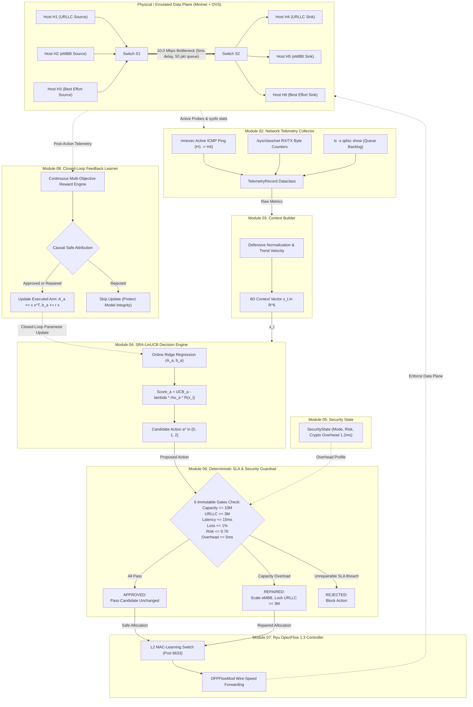

# AI-Driven Safe Dynamic Network Slicing for SLA-Preserving SDN Networks
## Complete Master Project Explanation, Technical Architecture & Conceptual Foundation

---

## Table of Contents
1. [The Real-World Networking Problem](#1-the-real-world-networking-problem)
2. [Problem Statement Formulations](#2-problem-statement-formulations)
3. [Why This Project? Technology & Architectural Trade-offs](#3-why-this-project-technology--architectural-trade-offs)
4. [End-to-End System Architecture & Dataflow](#4-end-to-end-system-architecture--dataflow)
5. [Topology & Physical Bottleneck Specifications](#5-topology--physical-bottleneck-specifications)
6. [Logical Slice vs. Physical Enforcement Distinction](#6-logical-slice-vs-physical-enforcement-distinction)

---

## 1. The Real-World Networking Problem

### 1.1 What is Network Slicing?
In traditional telecommunication and computer networks, a physical network treats all traffic relatively uniformly using "best-effort" forwarding. However, modern 5G and emerging 6G systems must simultaneously support applications with completely incompatible performance demands over the same shared physical infrastructure:
- **Ultra-Reliable Low-Latency Communication (URLLC):** Requires strict packet delivery time ($\le 15.0\text{ ms}$) and near-zero packet loss ($\le 1.0\%$). Examples include autonomous vehicle collision avoidance, telesurgery, smart electrical grid protection, and industrial factory robotics.
- **Enhanced Mobile Broadband (eMBB):** Bandwidth-intensive applications that require high data transfer rates, such as 4K/8K video streaming, augmented reality, and bulk data synchronization.
- **Best-Effort (BE):** Standard background internet traffic (email, web browsing, background updates) that has no explicit latency or throughput guarantees.

**Network Slicing** is the virtualization technology that divides a single shared physical network into multiple isolated, logical virtual networks ("slices"), each tailored to the QoS requirements of a specific traffic class.

### 1.2 What is Software-Defined Networking (SDN)?
In conventional networks, routers and switches make forwarding and QoS decisions independently using distributed firmware (the control plane and data plane are tightly bundled inside proprietary hardware). 

**Software-Defined Networking (SDN)** decouples the network into two distinct layers:
1. **The Data Plane (Forwarding Layer):** Fast, simple switches (e.g., Open vSwitch) whose sole job is to match packet headers against flow tables and forward packets at line rate.
2. **The Control Plane (Brain Layer):** A centralized software controller (e.g., Ryu) that communicates with switches via a standardized protocol (OpenFlow 1.3). The controller maintains a global view of the network and programmatically installs, modifies, and deletes forwarding rules and bandwidth meters.

### 1.3 What Happens When Video Traffic Surges (The Starvation Problem)
Consider a shared physical bottleneck link with **10.0 Mbps** total capacity connecting two network aggregation switches (`S1` and `S2`).
- Under normal conditions, URLLC traffic requires a modest rate (e.g., $1.0\text{ Mbps}$), eMBB uses $4.0\text{ Mbps}$, and Best Effort uses $2.0\text{ Mbps}$. Total utilization is $7.0\text{ Mbps} \le 10.0\text{ Mbps}$. All packets flow through switch egress buffers with minimal queuing delay ($RTT \approx 10\text{ ms}$).
- **The Congestion Event:** Suddenly, an eMBB host initiates a burst of multiple 4K video streams or heavy UDP downloads, injecting **$9.0\text{ Mbps}$** into switch `S1`. Total incoming traffic surges to $1.0 + 9.0 + 2.0 = 12.0\text{ Mbps}$, which exceeds the $10.0\text{ Mbps}$ physical link capacity.
- **Bufferbloat & Queuing Delay:** Switch `S1` cannot transmit packets faster than 10.0 Mbps. The excess packets accumulate in the switch's egress FIFO queue.
- **URLLC Starvation:** Although URLLC packets are tiny and only consume 1.0 Mbps, they arrive at switch `S1` and are placed behind hundreds of bulk eMBB packets in the First-In-First-Out buffer. URLLC packets experience severe serialization delay.
- **SLA Violation:** The URLLC round-trip time jumps from $10.15\text{ ms}$ to over **$29.88\text{ ms}$ average and $122.44\text{ ms}$ peak**. For an autonomous vehicle that requires a braking command within 15 ms, this delay is catastrophic.

### 1.4 The Empirical Proof in Our Project
Before implementing any dynamic slicing algorithm, we ran controlled physical baseline experiments on our topology (documented in `README.md` and `PROJECT_PHASES_EXPLANATION.md`):
- **Baseline 1 (URLLC Alone / Idle Link):** URLLC latency averaged **10.15 ms** with **0.0% packet drop**.
- **Baseline 2 (Unregulated eMBB Surge at 9.0 Mbps via iperf3):**
  - Average URLLC latency surged to **29.88 ms**.
  - Peak latency reached **122.44 ms**.
  - The 15.0 ms SLA threshold was heavily violated.

This empirical finding proved that an unmanaged network cannot preserve low-latency SLAs during bandwidth surges.

### 1.5 Why Fixed Bandwidth Allocation Fails
A simple engineering instinct is to partition the 10 Mbps pipe rigidly: lock URLLC to 3 Mbps, eMBB to 5 Mbps, and Best Effort to 2 Mbps.
- **The Inefficiency Problem:** Network traffic is inherently bursty. When the URLLC host is idle (using only 0.2 Mbps) and the eMBB video user needs 8 Mbps, static slicing strictly limits eMBB to 5 Mbps. Nearly 3 Mbps of link capacity sits completely idle while the video user suffers buffering and degraded quality.

### 1.6 Why Unconstrained AI is Dangerous
To reclaim idle bandwidth dynamically, research commonly applies machine learning (Reinforcement Learning or Contextual Bandits) to adjust bandwidth allocations on the fly.
**However, pure AI without deterministic safety is dangerous:**
- Machine learning algorithms learn through **stochastic exploration** (trial and error).
- To find optimal rewards, the AI explores actions, including aggressive allocations to eMBB.
- In a live physical network, exploration errors cause immediate queue accumulation and bufferbloat, crashing URLLC latency and breaching SLAs.
- A reward penalty applied *after* the fact cannot undo the fact that a mission-critical packet was already delayed or dropped on the wire.

---

## 2. Problem Statement Formulations

### 2.1 One-Sentence Problem Statement
> How to dynamically allocate shared SDN link bandwidth to maximize throughput for elastic traffic while deterministically guaranteeing that Ultra-Reliable Low-Latency Communication (URLLC) never breaches its 15.0 ms Service Level Agreement (SLA) due to stochastic AI exploration errors.

### 2.2 30-Second Viva Pitch
> "In shared 5G/6G networks, heavy video streaming causes bufferbloat that starves latency-sensitive traffic like autonomous driving commands. Static bandwidth partitioning prevents starvation but wastes up to 40% of link capacity when slices are quiet. If we use AI to allocate bandwidth dynamically, standard AI explores by trial-and-error, causing dangerous SLA breaches during learning. Our project solves this by separating optimization from safety: an SRA-LinUCB contextual bandit explores bandwidth optimization, but a deterministic pre-execution guardrail mathematically blocks or repairs any unsafe allocation before it can reach the OpenFlow switches."

### 2.3 One-Minute Faculty Explanation
> "Our project addresses multi-tenant resource contention in Software-Defined Networks. On a shared 10 Mbps bottleneck link, high-throughput eMBB traffic and low-latency URLLC traffic compete for egress buffer space. Under unregulated bursts, URLLC latency surges from 10 ms to over 30–120 ms, violating the 15 ms mission-critical SLA.
> 
> To solve this, we developed a closed-loop system with three core innovations:
> First, a non-invasive telemetry collector and context builder that extracts a normalized 6-dimensional network state vector including temporal latency velocity.
> Second, a Security- and Risk-Aware LinUCB contextual bandit that optimizes slice allocations while penalizing risky exploration during congestion.
> Third, an independent deterministic guardrail that sits between the AI and the OpenFlow switches. It enforces six immutable physical and operational gates—including bandwidth capacity, latency ceilings, and WireGuard cryptographic overhead—deterministically repairing over-budget allocations to ensure zero SLA breaches.
> Across 114 automated tests and comparative benchmarking, our system achieves zero SLA breaches while delivering higher throughput than static partitioning."

### 2.4 Detailed Technical Problem Statement
Formally, let physical bottleneck link capacity be $C = 10.0\text{ Mbps}$. At discrete control interval $t$, let $K$ slices request bandwidth shares $\mathbf{a}_t = [B_{\text{URLLC}}, B_{\text{eMBB}}, B_{\text{BE}}]^T$.
The optimization objective is:
$$\max_{\mathbf{a}_t} \sum_{k \in \text{slices}} \text{Throughput}_k(t)$$
Subject to the hard physical and operational constraints:
1. $\sum_{k} B_k(t) \le C \quad \forall t$
2. $B_{\text{URLLC}}(t) \ge B_{\text{min}} = 3.0\text{ Mbps} \quad \forall t$
3. $RTT_{\text{URLLC}}(t) = RTT_{\text{base}} + \frac{Q(t) \cdot P_{\text{MTU}}}{C} + \Delta_{\text{crypto}} \le 15.0\text{ ms} \quad \forall t$
4. $\text{PacketLoss}_{\text{URLLC}}(t) \le 1.0\% \quad \forall t$
5. $\text{SecurityRisk}(t) \le 0.70 \quad \text{and} \quad \Delta_{\text{crypto}}(t) \le 5.0\text{ ms}$

Standard AI methods cannot enforce hard constraints because their policies are probabilistic. The technical problem is designing an algorithmic architecture that combines online contextual learning with zero-tolerance deterministic safety constraints.

### 2.5 The Specific Gap We Address
Most literature falls into two extremes:
1. Pure networking solutions (static queuing, strict priority queues) that lack intelligent, dynamic workload adaptation.
2. Pure machine learning solutions (Deep Q-Networks, PPO) that treat safety as an afterthought by tuning reward penalties, accepting thousands of SLA violations during training.

Our project bridges this gap with a **hybrid architecture**: statistical machine learning proposes candidate optimizations, while a deterministic, rule-based guardrail guarantees safety.

### 2.6 Objectives & Scope
- **Objective 1:** Emulate a multi-tenant slicing network in Mininet with OpenFlow 1.3 switches controlled by Ryu.
- **Objective 2:** Build an automated telemetry collection engine capable of probing latency across Mininet network namespaces.
- **Objective 3:** Implement an online contextual bandit (SRA-LinUCB) that adapts allocations based on a 6D network context.
- **Objective 4:** Implement a deterministic SLA and Security Guardrail enforcing 6 invariant gates with automatic allocation repair.
- **Objective 5:** Implement a closed-loop reward engine with causal safe attribution for online learning.
- **Objective 6:** Build a first-principles simulation benchmark comparing Static, Unsafe Dynamic, and Proposed AI-Safe systems across a standardized 20-step dynamic workload.

### 2.7 What We Have Demonstrated vs. What Remains
- **Demonstrated & Verified (Modules 1–9):**
  - Mininet topology and baseline congestion proof (`topology/topology.py`).
  - Ryu L2 MAC-learning controller (`controller/ryu_controller.py`).
  - Namespace-aware telemetry probing and Linux `tc` queue parsing (`telemetry/monitor.py`).
  - 6D context extraction and temporal velocity calculation (`ai/context_builder.py`).
  - SRA-LinUCB algorithm with ridge regression online updates (`ai/linucb.py`).
  - Security state modeling and WireGuard adapter fallback (`security/`).
  - 6-gate deterministic guardrail with allocation repair (`guardrail/`).
  - Closed-loop reward engine and causal feedback learner (`feedback/`).
  - Trace-driven comparative benchmark with 24-column CSV logs, summary tables, and plots (`experiments/`).
  - **114 automated tests passing with 100% success.**
- **Planned Future Work (Phases 10–12):**
  - Live data-plane rate actuation via OpenFlow meters or `ovs-vsctl`/`tc` queues (`controller/slicing_actuator.py`).
  - Real-time web visualization dashboard (`dashboard/app.py`).
  - Single-command live closed-loop orchestrator (`run_live_system.py`).

---

## 3. Why This Project? Technology & Architectural Trade-offs

### 3.1 Architectural Comparison Matrix

| Approach | Latency Protection | Bandwidth Utilization | Sample Efficiency | Safety Guarantee | Computational Overhead |
|---|:---:|:---:|:---:|:---:|:---:|
| **Static Fixed Slicing** | High (10.15 ms) | Low (wastes idle capacity) | Instant (no learning) | Deterministic | Zero |
| **Heuristic Rule-Based** | Moderate | Moderate (rigid thresholds) | N/A (hardcoded) | Deterministic | Low |
| **Deep RL (PPO / DQN)** | Poor during training | High (after convergence) | Very Poor (10,000+ steps) | None (stochastic) | High (GPU / inference delay) |
| **Standard LinUCB** | Poor during spikes | High | Fast ($O(d^2)$ closed-form) | None (explores unsafely) | Very Low |
| **Proposed AI-Safe System** | **Strictly Preserved ($\le 12.51\text{ ms}$)** | **High (+4.2% over static)** | **Instant (online from step 0)** | **100% Deterministic (Module 6)** | **Very Low ($< 1\text{ ms}$ inference)** |

### 3.2 Detailed Design Decisions

#### 1. Why SDN Instead of Traditional Networking?
- *Traditional Networks:* QoS requires manually configuring every switch and router via CLI or SNMP. Distributed routers cannot coordinate dynamically across slices.
- *SDN:* Provides centralized programmatic control. A software agent can inspect global telemetry and update slice flow rules in milliseconds through OpenFlow.

#### 2. Why Mininet & Open vSwitch (OVS)?
- *Physical Testbed:* Requires thousands of dollars of commercial SDN switches and physical servers. Inflexible to rewire.
- *Simulation (NS-3):* Runs discrete-event packet simulations but does not execute real Linux network stacks, real kernel sockets, or real SDN controllers.
- *Mininet + OVS:* Runs real Linux network namespaces, actual kernel networking code, and standard Open vSwitch instances. Code tested in Mininet can deploy directly to physical OpenFlow hardware with minimal modification.

#### 3. Why Ryu and OpenFlow 1.3?
- OpenFlow 1.3 is the industry standard SDN protocol supporting per-flow meters, multipart statistics, and table pipelines. Ryu is pure Python, well-documented, asynchronous, and integrates cleanly with Python-based AI libraries (NumPy, PyTorch).

#### 4. Why Contextual Bandits (LinUCB) Instead of Deep RL?
- *Deep RL (DQN, PPO, A2C):*
  - Requires $10^4$ to $10^6$ training samples.
  - "Black box" neural networks cannot be mathematically certified for safety.
  - Neural network inference adds milliseconds of latency to SDN control loops.
  - Susceptible to catastrophic forgetting when traffic distributions shift.
- *LinUCB:*
  - Features provable sub-linear cumulative regret bounds: $O(\sqrt{d T \ln(T)})$.
  - Closed-form recursive updates requiring $O(d^2)$ operations ($d=6$, meaning only 36 multiplications).
  - Online learning operates effectively from step zero without offline pre-training.

#### 5. Why a Separate Guardrail Instead of Reward Penalties?
- A reward function is a **post-execution soft penalty**. If the AI chooses an unsafe allocation, the reward engine penalizes it with $-5.0$, but the packets have *already queued, delayed, or dropped on the physical wire*.
- The Guardrail is a **pre-execution deterministic gatekeeper**. It intercepts the candidate action before it reaches the switch and mathematically verifies capacity, latency, loss, and security.

---

## 4. End-to-End System Architecture & Dataflow



---

## 5. Topology & Physical Bottleneck Specifications

Verified directly against [`topology/topology.py`](file:///C:/Users/Gadi%20Srihari%20Reddy/AI-Safe-Dynamic-Slicing/topology/topology.py):

```text
 H1 (10.0.0.1) ──┐                                            ┌── H4 (10.0.0.4)
 H2 (10.0.0.2) ──┼── Switch S1 ══════ Bottleneck Link ══════ Switch S2 ──┼── H5 (10.0.0.5)
 H3 (10.0.0.3) ──┘   (OpenFlow13)    (s1-eth4 <-> s2-eth4)   (OpenFlow13) └── H6 (10.0.0.6)
                                     Bandwidth: 10.0 Mbps
                                     Delay: 5.0 ms each way
```

### Technical Parameters:
- **Switches:** Two Open vSwitch instances (`s1` and `s2`), running OpenFlow 1.3.
- **Controller:** RemoteController connecting to `127.0.0.1:6633`.
- **Host Links:** Host-to-switch links (`h1-s1`, `h2-s1`, `h3-s1`, `h4-s2`, `h5-s2`, `h6-s2`) use default Mininet links (full line-speed virtual Ethernet pairs with zero artificial delay).
- **Bottleneck Link:** The inter-switch link (`s1` $\leftrightarrow$ `s2`) is defined as:
  ```python
  self.addLink(s1, s2, cls=TCLink, bw=10, delay='5ms')
  ```
- **Delay Schedulers:** Mininet's `TCLink` configures Linux `tc netem` on **both** interface endpoints (`s1-eth4` and `s2-eth4`). Each interface applies a 5.0 ms delay to outgoing packets. Therefore, the minimum theoretical propagation round-trip time is:
  $$RTT_{\text{prop}} = 5.0\text{ ms (forward)} + 5.0\text{ ms (reverse)} = 10.0\text{ ms}$$
  Empirical idle ping measurements confirm a baseline latency of **$10.15\text{ ms}$** (10.0 ms propagation + 0.15 ms Linux kernel context switching).

---

## 6. Logical Slice vs. Physical Enforcement Distinction

An essential distinction for academic defense:

1. **Logical Slice (Implemented in Current Prototype):**
   - In [`topology/topology.py`](file:///C:/Users/Gadi%20Srihari%20Reddy/AI-Safe-Dynamic-Slicing/topology/topology.py) and [`slicing/slice_config.py`](file:///C:/Users/Gadi%20Srihari%20Reddy/AI-Safe-Dynamic-Slicing/slicing/slice_config.py), slices are defined by **traffic endpoints and IP/port tuples**:
     - URLLC Slice: `H1 (10.0.0.1)` $\leftrightarrow$ `H4 (10.0.0.4)`
     - eMBB Slice: `H2 (10.0.0.2)` $\leftrightarrow$ `H5 (10.0.0.5)`
     - Best Effort Slice: `H3 (10.0.0.3)` $\leftrightarrow$ `H6 (10.0.0.6)`
   - Slices share the single physical 10 Mbps bottleneck interface (`s1-eth4`).

2. **Physical / Operational Bandwidth Enforcement:**
   - In a production SDN network, physical bandwidth enforcement requires hardware rate limiters, such as:
     - *OpenFlow 1.3 Meter Bands (`OFPMeterMod`):* Rate limits individual flow entries directly in switch hardware.
     - *Linux HTB Classes (`tc class add`):* Binds specific switch queues (`queue_id 0, 1, 2`) to separate Hierarchical Token Bucket classes with explicit `rate` and `ceil` values.
   - **Current Implementation Reality:**
     - The current Ryu controller ([`controller/ryu_controller.py`](file:///C:/Users/Gadi%20Srihari%20Reddy/AI-Safe-Dynamic-Slicing/controller/ryu_controller.py)) functions as an L2 MAC-learning switch for packet forwarding.
     - Dynamic rate actuation (pushing guardrail decisions to OpenFlow meters or HTB queues) is **Phase 10 future work**.
     - In Module 09 benchmarking, physical queuing is simulated using a first-principles fluid FIFO model based on real network parameters.
